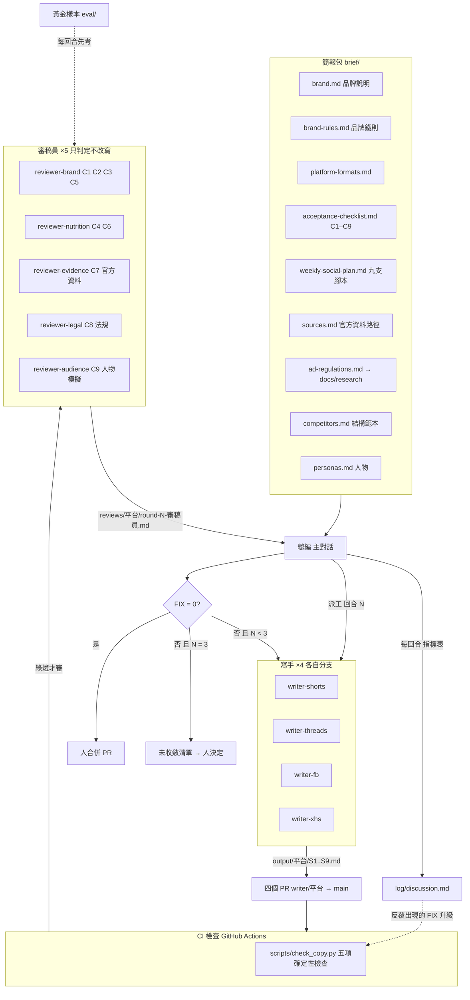
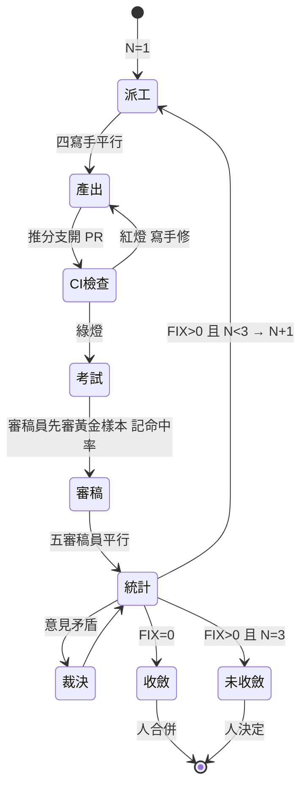

# SDD｜社群內容代理迴圈 系統設計

版本 1.0｜2026-09-18｜名詞依 `CONTEXT.md`；設計語言依 codebase-design：模組、介面、接縫、深度。

## 1. 一句話
四個寫手對著人物、借同業結構，在各自分支平行產出；CI 擋確定性錯誤，五個審稿員擋判斷性錯誤，總編統計與裁決，人決定合併；最多三回合；驗證器本身有成績單。

## 2. 架構圖



## 3. 迴圈狀態機



## 4. 模組與介面

| 模組 | 介面（呼叫者要知道的全部） | 實作深度 | 接縫 |
|---|---|---|---|
| 簡報包 | 一組固定路徑的 Markdown 檔 | 淺，純資料 | 檔案系統 |
| 寫手 | 輸入：回合 N。輸出：`output/<平台>/S1..S9.md`，檔頭三行固定 | 深：讀規則、讀人物、讀範本、讀審稿、寫九份、自檢 | 代理定義檔；換模型只改 `model` 欄位 |
| CI 檢查 | 輸入：`output/` 目錄。輸出：exit code 與逐項報告 | 中：五項規則，純函式，可測 | Python 函式 `check_dir(path) -> Report` |
| 審稿員 | 輸入：回合 N。輸出：`reviews/<平台>/round-N-<名>.md`，每平台 9 列，末行 FIX 數 | 深：讀規則、讀 36 檔、逐條判定 | 代理定義檔 |
| 受眾審稿員 | 同上，多一張人物乘文案的反應表 | 深：每人物讀每文案 | 代理定義檔；人物來自 `brief/personas.md` |
| 總編 | 輸入：五份審稿末行。輸出：派工訊息、裁決、討論記錄、指標表 | 淺：規則簡單，交給 skill | `.claude/skills/run-week/SKILL.md` |
| 黃金樣本 | `eval/<案例>.md` 加 `eval/expected.md` | 淺，純資料 | 檔案 |
| 討論記錄 | 一個 Markdown 檔 | 淺 | 檔案 |

刪除測試：拿掉 CI 檢查，五項規則會散到五個審稿員裡各判一次，複雜度重現。拿掉總編，寫手要自己讀五份審稿並判斷矛盾，複雜度重現。拿掉黃金樣本，審稿員的品質沒有數字，只剩感覺。

## 5. 驗證分工（誰擋什麼）

| 層 | 擋什麼 | 為什麼放這層 |
|---|---|---|
| CI（程式） | 檔案數、檔頭、硬性守門三條、字數上限、單一行動引導 | 有客觀答案，程式比模型可靠且免費 |
| 審稿員（模型） | 鉤子強弱、語氣、標注完整、來源比對、法規風險、人物反應 | 需要判斷，且五個審稿員各自獨立，互不看對方思路 |
| 總編（模型） | 審稿員之間的矛盾 | 需要跨審稿員的視角 |
| 人 | 合併、未收斂、授權、抽查判定 | 驗證器不成熟時，人是出口（ADR-0002） |

## 6. 驗證器成熟計畫

驗證器成熟的定義：它的判定被量過，錯的被修過，越來越多判斷變成不需要判斷。總指標是推翻率。

| 機制 | 做法 | 產物 | 今天做到 |
|---|---|---|---|
| 黃金樣本 | `eval/` 放六份文案：三份埋違規（保證句、大卡數字、雙行動引導、表面合規但空洞各一），三份乾淨。每回合審稿員先審它們 | `eval/expected.md` 對照命中率 | 六份，跑一次 |
| 一致性測試 | 同一審稿員同一檔審兩次，記不一致的條件編號 | 不一致的條件回頭改寫得更可判定，或升級為 CI | 品牌審稿員跑一次 |
| 升級 | 同一 FIX 模式連兩回合出現 → 寫成 CI 規則加測試 → PR → 人核准 | `scripts/check_copy.py` 規則數增加，審稿員判斷面縮小 | 示範一次（例如「收藏」不算行動引導） |
| 人工抽查 | 每回合人隨機看五筆判定，同意或推翻，記進討論記錄 | 推翻率 | 第一回合做 |
| 外部真值 | 營養句對國健署資料，法規對條文原文，人物反應對基準週真實數據 | 有依據／無來源／牴觸；人物校準 | 前兩項今天，人物校準等基準週 |
| 反遷就 | 寫手讀得到清單，可能學會剛好過關。黃金樣本放「表面合規反例」，受眾審稿員不看清單只看人物反應 | 抓到「全過但很爛」的文案 | 反例一份 |

每回合指標表（寫進討論記錄）：FIX 數、重複 FIX 模式數、審稿員矛盾次數、黃金樣本命中率、人推翻率、CI 規則數。

## 7. 人物層

人物不是猜的。來源：官網 13 個案例的職業與起點體重、三個深度案例的心理狀態、FAQ 五題的疑問、同業留言區用語。每個人物有：職業與年齡、減肥史、這週處境（中秋）、口頭禪、平台習慣、看到什麼會滑走、看到什麼會停。寫手每支腳本指定一個主要人物；受眾審稿員讓全部人物讀每份文案，回報：前三秒留不留、看不看得懂、會做什麼（滑走／留言／存／點 LINE）、一句人物口吻的反應、最大疑慮。C9 判定：留下的人物過半且至少一位做出目標行動為 PASS。人物是代理指標，成熟計畫裡靠基準週真實數據校準。

## 8. 目錄與版本

```
bgg-social-agent/
├── CLAUDE.md               路由：讀哪個檔、產出放哪
├── CONTEXT.md              名詞表
├── brief/                  簡報包（輸入，唯一事實來源）
├── eval/                   黃金樣本與答案
├── .claude/agents/         九個代理定義
├── .claude/skills/run-week 迴圈驅動
├── scripts/check_copy.py   CI 檢查
├── tests/test_check_copy.py
├── .github/workflows/copy-check.yml
├── output/<平台>/S1..S9.md  文案，只留一份，回合看 git
├── reviews/<平台>/round-N-<審稿員>.md
├── log/discussion.md
└── docs/ PRD SDD adr/ research/ HOMEWORK.html
```

分支：`main` 放 harness 與文件；`writer/<平台>` 四條分支各放自己的 `output/<平台>/` 與 `reviews/<平台>/`。每條分支一個 PR。回合 N 的改動是同一分支上的新提交，PR 的 diff 就是「這回合改了哪幾句」。

## 9. CI 檢查規格（`scripts/check_copy.py`）

| 項 | 規則 | 失敗訊息含 |
|---|---|---|
| K1 檔案數 | 每平台恰好 S1–S9 九檔 | 平台、缺或多的編號 |
| K2 檔頭 | 前三行：`# S<n>｜…｜<平台>`、`回合：N`、`本輪修改：` | 檔名、哪一行 |
| K3 硬性守門 | 正文不含「保證」；不含「大卡」「kcal」；不含「保健食品」，不含「藥」與「推薦」同句 | 檔名、命中字串 |
| K4 字數 | shorts 正文 ≤ 260、threads ≤ 300、fb ≤ 400、xhs 正文 ≤ 300（不含檔頭與標注括號） | 檔名、實際字數 |
| K5 單一行動引導 | 「留言」與 `lin.ee` 不同時出現；`lin.ee` 最多一次 | 檔名 |

介面：`check_dir(root: Path) -> Report`，`Report.ok: bool`，`Report.failures: list[Failure(platform, script, rule, message)]`。命令列：`python scripts/check_copy.py output/` 失敗 exit 1。測試先寫（tdd 技能），每條規則至少一個通過與一個失敗案例。

## 10. 代理通訊
寫手與審稿員不互相傳訊。唯一媒介是檔案與 git：寫手讀審稿檔、審稿員讀文案檔。總編用派工訊息把回合編號交給代理，用 SendMessage 把 FIX 清單交回同一個寫手以保留它的記憶。理由見 ADR-0001。

## 11. 失敗處理
- CI 紅燈：不進審稿，寫手依失敗訊息修，同回合重推。
- 審稿檔缺列：總編視為該平台本回合無效，重派該審稿員。
- 黃金樣本命中率低於三分之二：該審稿員本回合的判定標「低信度」，人抽查加倍。
- 三回合未收斂：不合併，`log/discussion.md` 列未收斂項目與最後一次 FIX 原句，交人。
- 代理回報「工具不可用」：記進討論記錄，不當作完成。

## 12. 可觀測性
每回合固定產物：四份文案分支提交、五份審稿檔乘四平台、討論記錄一節含指標表。任何一份缺，回合不算完成。

## 13. 未做與未來
- 未用 Agent Teams（需 `CLAUDE_CODE_EXPERIMENTAL_AGENT_TEAMS=1`），因為檔案媒介已足夠且可追溯。
- 未接 GPT 或 DeepSeek 當審稿員；介面是代理定義檔，未來換模型只改 `model` 欄位。
- 未用真實數據校準人物，等基準週。
- 未做網頁版圖，Mermaid 在 GitHub 直接顯示。
