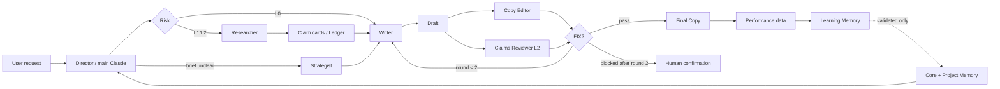

# Architecture

## Why this architecture

v1 把所有平台寫手與五種 reviewer 固定綁在每回合，適合展示多代理，但日常使用成本高、上下文重複，也容易讓模型彼此產生大量低價值 FIX。v2 改成「routing by risk」。

真正要長期保存的不是每次 agent 對話，而是：品牌核心、可用 claim、決策、發布結果、重複有效／失效模式。
