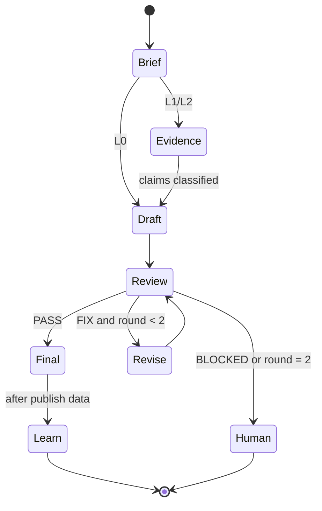

# SDD｜BGG Copy Agent v2

## System boundary

Claude Code 是 runtime；Git repo 是可稽核狀態；Markdown memory 是 business source of truth；subagent memory 是角色型經驗；外部 web／文件是 evidence source。

## Components

| Component | Responsibility | Writes |
|---|---|---|
| Main / Director | routing、風險分類、收斂 | current brief、run summary |
| Strategist | brief / campaign | work/strategy、plans |
| Researcher | claim cards / source verification | work/research、claim ledger |
| Writer | draft / revision | output |
| Claims reviewer | high-risk verdict | reviews/*-claims.md |
| Copy editor | copy quality verdict | reviews/*-copy.md |
| Validators | deterministic checks | stdout / CI |
| Learning skill | performance → reusable learning | memory/learning |

## Risk routing

```text
L0 = no external factual claim
  writer -> copy-editor

L1 = normal factual / time-sensitive claim
  researcher -> writer -> copy-editor

L2 = health / nutrition / mechanism / case / legal / ad claim
  researcher -> writer -> [claims-reviewer || copy-editor] -> writer if FIX
```

## State machine



## Invariants

- `memory/core` 不由一般寫稿任務修改。
- BLOCKED claim 不得出現在公開正文的肯定句。
- reviewer 不直接覆寫 final copy。
- 一份 asset 一個 primary CTA。
- 每個 revision round 保留 run summary。
- dynamic metrics require explicit freshness check。

## Portability

不使用 v1 的機器固定路徑。外部資料若放在本機，在 `source-registry.md` 只登記 logical source ID，本機路徑寫在 `references/local-sources.md`（`check_memory.py` 禁止 memory/ 內出現本機路徑）；不存在時 researcher 改用官方 web 或回報 BLOCKED。
