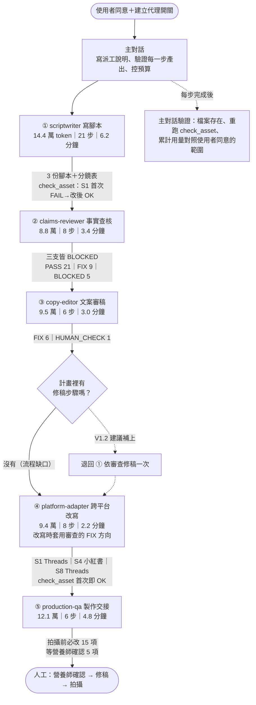
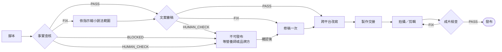
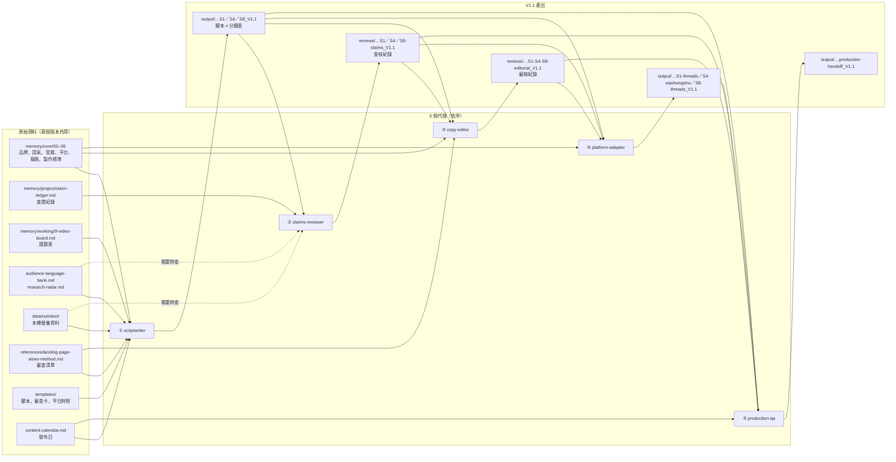

# 代理分工測試報告｜V1.1｜2026-09-19

- 範圍：S1（把秤丟掉）、S4（烤肉一個規則）、S8（破功後的真正陷阱），每支走完 5 個角色。
- 方式：主對話依序派出 5 個 subagent，每個角色一個代理、一次處理 3 支；代理之間只透過檔案交接。
- 獨立性：5 個代理都禁止讀取任何 `_V1.0_20260919` 檔、`decision-log.md`、`HANDOFF`，所以 V1.1 是從同樣的原始資料獨立做出來的。
- 使用者同意：2026-09-19「完整版可以」→ 範圍改 3 支後「可以」→ 第 2 個代理後選 B「剩下 4 個代理都跑」→「不用合成」。代理開關 `~/.claude/ALLOW_AGENTS` 由使用者自行建立。

> 圖用 Mermaid 語法。在 GitHub 會直接顯示成圖；在 VS Code 要安裝「Markdown Preview Mermaid Support」擴充功能，再按 `Ctrl + Shift + V` 預覽。

---

## 1. 流程圖（這次實際怎麼跑）

### 審查結果怎麼決定下一步（系統設計，含這次沒走到的路）

---

## 2. 關係圖（誰讀什麼、寫出什麼、交給誰）

重點：每個代理只拿得到**前面代理寫出的檔案**，看不到彼此的思考過程。這就是「獨立審查」的來源，也是每個代理都要重新讀資料、成本較高的原因。

---

## 3. 用量

| 代理 | token | 步數 | 時間 |
|---|---:|---:|---:|
| ① scriptwriter | 143,928 | 21 | 6.2 分 |
| ② claims-reviewer | 88,262 | 8 | 3.4 分 |
| ③ copy-editor | 95,421 | 6 | 3.0 分 |
| ④ platform-adapter | 94,115 | 8 | 2.2 分 |
| ⑤ production-qa | 120,893 | 6 | 4.8 分 |
| **合計** | **542,619** | 49 | 19.6 分 |

| 預估對照 | 預估 | 實際 |
|---|---|---|
| 最初計畫（5 個代理） | 20–27 萬 | 54.3 萬（約 2 倍） |
| B 方案（②–⑤，使用者同意 18–28 萬，後改分開跑預估 37–39 萬） | 37–39 萬 | 39.9 萬（超出上限約 0.9 萬） |

- 每個代理有約 **9 萬的固定開銷**：每一步都要重新帶入系統規則、全域與專案 CLAUDE.md、工具說明。步數從 21 降到 6，用量只從 14.4 萬降到約 9.5 萬。
- 換算（粗估）：08:00 額度重置後，② ③ 兩個代理共 18.3 萬，5 小時額度用了 5%（含主對話用量）→ **每 1% 最多約 3.7 萬 token**（保守估計，Max 5x 方案）。
- 主對話（V1.0）的用量沒有單獨計量，無法和 V1.1 直接比較 token。

---

## 4. V1.0 和 V1.1 比較（只比 S1、S4、S8）

| 項目 | V1.0（主對話一人分飾各角色） | V1.1（5 個代理分工） |
|---|---|---|
| 寫稿與審稿 | 同一個模型，獨立性有限 | 不同代理，只透過檔案交接 |
| 修稿回合 | 有：寫 → 審 → 改一次 | **沒有**（計畫漏了），FIX 留到拍攝前 |
| 行為建議（看盤子、夾取順序）的判定 | HUMAN_CHECK（等營養師確認） | **BLOCKED**（「不確定就擋下」） |
| 查核找到的問題數 | S4 FIX 2（已改） | FIX 9、BLOCKED 5 |
| 審稿找到的問題數 | 3 支共 FIX 3 | FIX 6、HUMAN_CHECK 1 |
| 交接包待辦 | 拍攝前無必改，待確認 5 支 | 拍攝前必改 15 項、等確認 5 項 |

### 只有 V1.1 抓到的問題

1. S4「為什麼是它們？」暗示雞腿、肉片鈉比較低，這個比較沒有來源。
2. S4「不用戒」沒有給需要限鈉的人醫囑提示。
3. S1 的受眾 P3「秤重焦慮者」原本指常量體重的人，但腳本講的是秤食物。**這個問題 V1.0 也有**，要一起處理。
4. S8 的風險等級應從 L0 調成 L1（「不用少吃一餐補」也要等營養師確認）。

### 只有 V1.0 做到的

1. **營養師原話逐字保留**。V1.1 寫稿時把「我」改成「我們」，被查核代理抓到。
2. **有修稿回合**，交到拍攝手上的是已修正的稿子。
3. **跨支一致的系列設計**：S1、S7、S9 共用「看盤子三件事」，營養師確認一次三支適用。V1.1 只看 3 支，看不到整週。

### 結論

- **獨立審查有用**：V1.1 找到 4 個 V1.0 自己審稿時沒發現的問題，其中一個（P3 受眾定義）連 V1.0 也適用。
- **但分工本身不會讓寫稿變好**：V1.1 的寫稿代理犯了 V1.0 沒犯的錯（改動原話），是靠查核代理才抓到。
- **成本高**：3 支影片用了 54 萬 token，每個代理的固定開銷約 9 萬。
- **流程要補一步**：審查之後沒有修稿，交接包就只能列出 15 項「拍攝前必改」，把修稿工作推給拍攝團隊。

---

## 5. V1.2 建議

| 做法 | 理由 | 預估影響 |
|---|---|---|
| 保留「寫稿」和「查核＋審稿」分開 | 獨立審查的價值在這裡 | — |
| 查核和審稿合成一個代理 | 兩者都是「讀稿挑問題」，合併省一筆固定開銷 | 省約 9 萬 |
| 加修稿步驟：審查結果退回寫稿代理改一次（接續原代理，不新開） | 補上流程缺口 | 多約 3–5 萬 |
| 跨平台改寫和製作交接合成一個代理 | 兩者都照前面結果做，不需要彼此獨立 | 省約 9 萬 |
| 派工說明要求一次讀完、一次寫完 | 步數少，每步重帶的內容就少 | 每個代理省約 1–4 萬 |
| 寫稿代理只給需要的檔案 | ① 讀了全部品牌資料，是最貴的一步 | 省約 3–5 萬 |

V1.2 預估：3 個代理（寫稿＋修稿、查核審稿、改寫交接），約 30–35 萬，比 V1.1 少約 20 萬。

---

## 6. 待處理

- [ ] 使用者刪除代理開關：`! rm ~/.claude/ALLOW_AGENTS`
- [ ] P3 受眾定義與「秤食物」不符，V1.0 的 S1 也要一起確認
- [ ] S8 風險等級是否由 L0 改為 L1（使用者決定）
- [ ] content-calendar 仍以 V1.0 為發布版本（代理 ⑤ 指出的 3 處「不一致」是因為行事曆追蹤的是 V1.0，不是錯誤）；要改用 V1.1 發布時再更新
